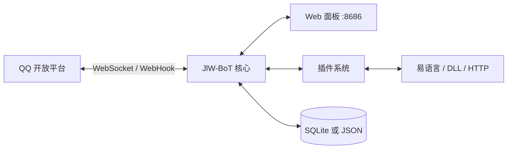

# JlWorld
成品下载： [www.jlworld.net](https://www.jlworld.net/QQBOT)
# JlW-BoT

> 零 npm 依赖的 Node.js QQ 官方机器人框架：多账户、Web 面板、插件市场、SQLite、在线更新。


## 这是什么

JlW-BoT 是一个面向 **QQ 官方机器人开放平台** 的机器人框架，使用 Node.js 编写，**不需要 `npm install`**，能力尽量用 Node 内置模块完成。

它把「机器人接入 + 可视化管理 + 插件运行 + 数据存储 + 更新部署」放在一个目录里：

- 双击 `启动机器人.cmd` 启动，成品包自带 Windows x64 Node 运行时
- 浏览器打开 `http://127.0.0.1:8686` 管理
- 数据统一放在 `~JlWBoT`，整个目录拷走即可迁移
- 插件支持 JS / HTTP / 长轮询 / 独立进程 / 易语言 DLL

> 主要面向 Windows；QQ 官方接口与聚龙世界账户接口以官方文档为准。

## 架构



## 功能

### 机器人

- 多账户同时在线：每个账户独立 AppID / Secret / token / 网关 / WebHook / 消息统计
- WebSocket 与 WebHook 两种接入；断线重连、resume、4009 过期重连、Intents 回退
- 群聊 / 单聊 / 频道消息，进群、退群、加群申请等事件
- 被动回复严格区分 `msg_id`（+ `msg_seq`）与 `event_id`，避免用错接口
- 机器人自己发出的消息也会入库，可在面板回看

### Web 面板

- 概览、账户、连接、插件、市场、消息、日志、接口、设置
- 消息按日期看历史，支持账户/类型/关键词筛选，机器人发出的消息单独标记
- 点消息看「消息预览」：文字、Markdown、图片、卡片、`ark_data` 群公告
- 腾讯 `qqbot-*` 自定义标签自动解码/隐藏，中文百分号编码会还原
- 日志按日期/级别查看、下载；接口调用日志自动打码 token / secret
- 接口调试页内置 QQ 开放平台接口清单，按账户调用

### 插件

- 类型：`js`、`http`、`pull`、`process`、`dll`
- 易语言：32 位 DLL 通过 `dllhost.exe` 宿主加载；也可用 `pull` 长轮询 + `action` 回调
- 插件可带设置页、API 文档、测试事件；支持热重载、启用/停用、导入 zip/文件夹
- 内置插件市场：浏览、下载、安装、更新；市场代理支持内嵌面板
- 插件 token 鉴权；插件数据默认放各自 `data/`，也可用 VSQL 共享 SQLite

### 存储与运维

- 默认 SQLite（Node 内置 `node:sqlite`），也支持 JSON/JSONL；面板可一键切换并迁移
- 日志/消息按日期查询、按保留天数清理；退出时自动 checkpoint
- 单实例锁、崩溃日志、端口看门狗、定时重启
- 在线更新器：从发布页下载 zip、校验版本、保留 `~JlWBoT` 数据
- 成品包内置 `runtime\node.exe`，不依赖系统 Node

## 快速开始

### 方式一：直接下载成品包

1. 到 [聚龙世界官网](https://www.jlworld.net/QQBOT) 下载 `JlW-BoT [v1.6.4].zip`
2. 解压，双击 `启动机器人.cmd`
3. 浏览器打开 <http://127.0.0.1:8686>
4. 用聚龙世界账户登录，在「账户」里填 QQ 机器人 AppID / AppSecret
5. 到 QQ 开放平台把回调地址/域名配置好（WebSocket 模式不需要公网入站）

### 方式二：源码运行

```bash
git clone https://github.com/Lm-gzKen/JlWorld.git
cd JlWorld
node src/index.js
```

要求 **Node.js 18.17+**，不需要 `npm install` 。

数据目录默认是项目下的 `~JlWBoT`（字面文件夹名，不是用户主目录）。

## 目录结构

```text
JlW-BoT/
├─ src/
│  ├─ core/       核心：Bot / 网关 / API / 存储 / 配置 / HTTP 服务
│  └─ web/        面板：原生 HTML/CSS/JS，无构建
├─ plugins/       插件与示例（JS / 易语言 / VSQL / 天气等）
├─ test/          单元 + 端到端测试（不依赖 npm）
├─ tools/         启动、停止、登录初始化、导出脚本
├─ docs/          部署、插件开发、API、易语言对接
├─ 插件市场/      插件市场源码（可选）
├─ start.cmd
└─ 启动机器人.cmd
```

## 文档

- [部署与脱机运行](docs/部署与脱机运行.md)
- [插件开发](docs/插件开发.md)
- [API 接口](docs/API接口.md)
- [易语言对接](docs/易语言对接.md)

## 安全

- **不要提交 `~JlWBoT`**：里面有 AppSecret、token、日志和消息
- 面板默认只监听 `127.0.0.1`；对外部署请加反向代理和 HTTPS
- 插件只从可信来源安装
- 发现密钥泄露：立即到 QQ 开放平台重置 AppSecret

## 说明

- 个人项目，非腾讯 / 聚龙世界官方；QQ 机器人接口以官方文档为准
- 欢迎 Issue / PR；大改动建议先开 Issue 讨论
- 仓库名 `JlWorld` 是历史命名，项目名是 **JlW-BoT**

## License

[BSD 3-Clause](LICENSE)。允许商用、修改、再分发；不得用作者/贡献者名义为衍生品背书。
